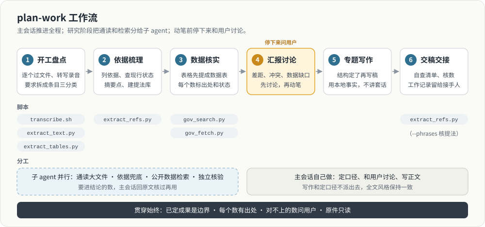
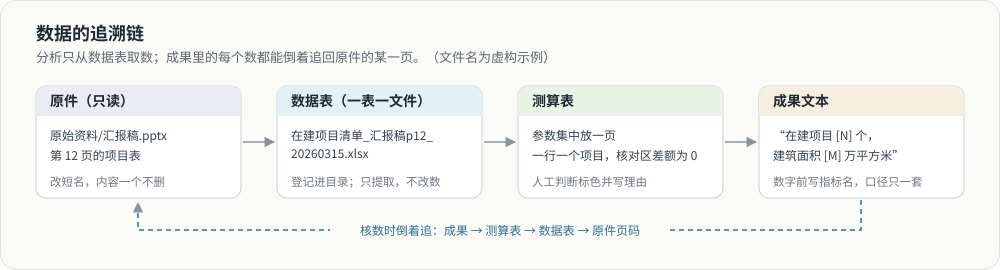

<div align="center">

# plan-work

**把规划咨询项目的做法写成 agent 的工作流。**

面向 Claude Code、Codex 等 agent 的 skill：开工盘点、上位依据梳理、数据核实、专题和文本写作。

[](LICENSE)
[](SKILL.md)
[](scripts)

</div>

---

## 这是什么

国土空间规划、住房规划、城市更新、控规、政策研究这类项目，材料多、改的人多，读者会对照合同、上位规划和数据逐条核对。我让 agent 帮忙做这类项目时，常遇到几个问题：

- 材料还没看全就动笔，录音、PPT 隐藏页和备注里交代的事没看到；
- 数字从 PPT、PDF 里直接抄，过几天说不清出处；几份材料的数对不上时，自己挑一个；
- 下游的专题改了上游已经定下的指标，提法和上位文件对不上；
- 写出来的段落换个城市名照样成立，还带着“落到本地”“详见专题×”“全闭环”这类 AI 味。

所以我把平时的做法写成 [SKILL.md](SKILL.md) 和 `references/` 里的几份参考文档，再配几个处理材料的脚本。agent 按它开工：先盘点、先列依据和数据缺口，向用户汇报并停下来讨论，定了再写。

它是纯提示词加几个独立脚本，不绑定某个地方或某类规划。文档里的例子以住房规划为主，地名、文件名和数字都是虚构的。



## 能做什么

### 1. 开工盘点与接手

逐个过项目文件夹：录音转文字，PPT 看隐藏页、备注和版面外的对象，Word 看修订痕迹，压缩包比对是否重复。把合同、任务书的要求拆成条目，逐条分成已有结论、要补的事实与数据、要补的策略；把核心指标在各份文件里的写法列成对照表，对不上的标出来。最后向用户汇报任务、差距、冲突和数据缺口，**先讨论，再动笔**。

接手别人的项目或换会话续做时，先读项目根目录的工作记录；没有就按同样的顺序建一份。见[开工盘点](references/开工盘点.md)、[文件组织](references/文件组织.md)。

### 2. 上位依据与对齐

`extract_refs.py` 先扫出各材料引用的规划、政策、标准和文号，对照各材料的“编制依据”章节怎么列；再派子 agent 独立通读、到官网查应列未列的文件和现行状态。整理成依据清单、依据要点和提法库，写作时定位、指标、提法和上位文件逐条对齐。见[上位依据与对齐](references/上位依据与对齐.md)。

### 3. 数据：先成表，再取数

材料里的表格（PPT、PDF、Word、图片、Excel 各工作表）和 GIS 属性表，先用 `extract_tables.py` 提成一表一个的数据表并登记目录，测算和文本只从数据表取数。每个数都有出处，状态分可用、待核、有误、无出处、缺五类；拿不到的如实写缺口，不推算凑数。现状、在建、库存、计划出自不同的表时，按项目逐个对账，每个项目只计一次；和上位指标比之前，先查清它按开工、供应、入市还是竣工统计。公开数据按项目材料、政府官网、统计出版物、部门公告、媒体的顺序找，国内政府网站用本机直连检索和抓取。见[数据来源与检索](references/数据来源与检索.md)。



### 4. 专题和文本写作

结构上，配套专题解释和深化已定成果，不另立指标；固定外壳可以保留，内部按技术路线、原则、研究思路、结论一条线串，每节只做一类事。内容先用成果原有的，其次上位文件和官方资料，缺的才自己提。

语言上，针对模型起草规划文本常见的三种惯性：**挂钩**（引文后接“落到本地”）、**防御**（“本文所称……只指”）、**讲文件**（“分别对应”“A决定了B”），各给出改法，并附一份定稿前的自查清单。见[专题和文本结构](references/专题和文本结构.md)、[写作语言](references/写作语言.md)。

### 5. 两类工作与子 agent 分派

活分两类，想法不同，不看谁来做。**前提工作**是资料整理、数据对账、测算复核：在已定口径下把数算准，交数据文件和影响说明，不重新讨论已定口径，不替方案下结论。**方案工作**是定目标、取舍、定结构和写作：目标按上位的指标名和口径，由规划期内安排的项目来定，测算只作校核。见[工作模式](references/工作模式.md)。

研究和数据分析阶段，通读大文件、依据兜底、公开数据检索、对账和测算复核、独立核验可以并行派给子 agent 或协作的 agent；定口径、写正文留在主会话。附各类 brief 模板和回收规矩：要进结论的数，主会话回原文核过再用。见[子 agent 分派](references/子agent分派.md)。

### 6. 脚本

| 脚本 | 做什么 |
|---|---|
| `extract_text.py` | 批量提取 docx、doc、rtf、pptx、pdf、xlsx、xls、et 的文字；PPT 标出隐藏页、备注和版面外对象，Word 附删掉的修订和批注 |
| `extract_tables.py` | 把表格和 GIS 属性表提成一表一个的 xlsx，命名为“名称_来源_提取日期”，自动登记目录 |
| `extract_refs.py` | 列出材料引用的规划、政策、标准和文号，对照各材料的依据章节；`--phrases` 统计引号里的提法 |
| `gov_search.py` | 调广东省政府网站群统一搜索；其他省份照[数据来源与检索](references/数据来源与检索.md)的方法找到接口后改写 |
| `gov_fetch.py` | 抓政府网页正文，列出并下载附件 |
| `transcribe.sh` | 录音转文字（Apple Silicon 的 Mac，本地 mlx-whisper） |

Python 脚本统一用 `python3 -I scripts/<脚本> --help` 看用法。

## 快速开始

**1. 安装**：克隆到 agent 的 skills 目录，目录名保持 `plan-work`。

```bash
# Claude Code
git clone https://github.com/shio-vinyl/plan-work.git ~/.claude/skills/plan-work
# Codex
git clone https://github.com/shio-vinyl/plan-work.git ~/.codex/skills/plan-work
```

其他支持 Agent Skills 的工具，克隆到它的 skills 目录即可。

**2. 直接对 agent 说**

> 这是一个新的住房规划配套专题项目，材料在 `项目/` 里，有合同、规划文本、汇报稿和一段交代任务的录音。先盘点，告诉我任务、已定的指标、依据和数据缺口。
>
> 把汇报稿和编制说明里的表格都提成数据表，核一下几份材料里的住房总量写法是否一致。
>
> 列出规划文本的编制依据，查一下哪些已经被取代、哪些征求意见稿已经正式发布。
>
> 按合同第三条写专题二的结构草案，先给我看标题和每节放什么，不要直接写正文。

agent 会读 [SKILL.md](SKILL.md)，按需查看 `references/` 里的参考文档，自己调用脚本。

## 依赖

脚本只在用到时才需要对应的工具，缺了会提示。

- **Python 3**，`openpyxl` 用于读写表格。`extract_tables.py` 处理 PDF、GIS 时需要 `pdfplumber`、`pyogrio`，缺了且装有 [uv](https://github.com/astral-sh/uv) 时会自动用临时环境运行。
- **文字提取**：`pdftotext`（poppler）读 PDF；`soffice`（LibreOffice）转换 doc、xls、et；macOS 自带的 `textutil` 读 doc、rtf；`tesseract`（含 `chi_sim` 语言包）识别图片文字。
- **录音转写**：Apple Silicon 的 Mac 和 `ffmpeg`。首次运行自动建虚拟环境、安装 mlx-whisper，从 ModelScope 下载约 1.6 GB 的模型，放在 `~/.cache/plan-work/asr`（可用 `PLAN_WORK_ASR` 改位置）。
- **政府网站检索**：`curl`，以及能直连国内网络的环境；境外的搜索引擎和抓取工具大多访问不到区级政府网站。

## 数据与隐私

- **项目材料**：脚本都在本地运行，但 agent 读到的内容会进入它所用模型的上下文。规划项目的材料常有未公开的内容，能不能交给 agent 处理，请按所在单位和委托方的保密要求自己判断。
- **录音转写**：在本机用 mlx-whisper 识别，录音不上传；联网只为首次下载模型。录音里有别人的讲话，转写前请确认你有权处理。转写稿未经校对，地名、单位常有同音错字。
- **政府网站检索**：`gov_search.py`、`gov_fetch.py` 只访问公开页面，请求发往 `search.gd.gov.cn` 和你给的网址，不带登录信息。请低频使用，遵守网站的使用条款，不要批量高频抓取。下载的附件存在 `--out` 目录。
- **仓库内容**：仓库不含任何真实项目的材料；文档和示意图里的地名、文件名和数字都是虚构示例。

## 许可证

[Apache License 2.0](LICENSE)

<sub>关键词：urban planning · territorial spatial planning · housing planning · urban renewal · policy research · AI agent · Claude Code skill · Codex skill · Agent Skills · LLM · 规划咨询 · 国土空间规划 · 住房规划 · 城市更新 · 控规 · 政策研究 · 专题研究 · 编制依据 · 数据核实</sub>
